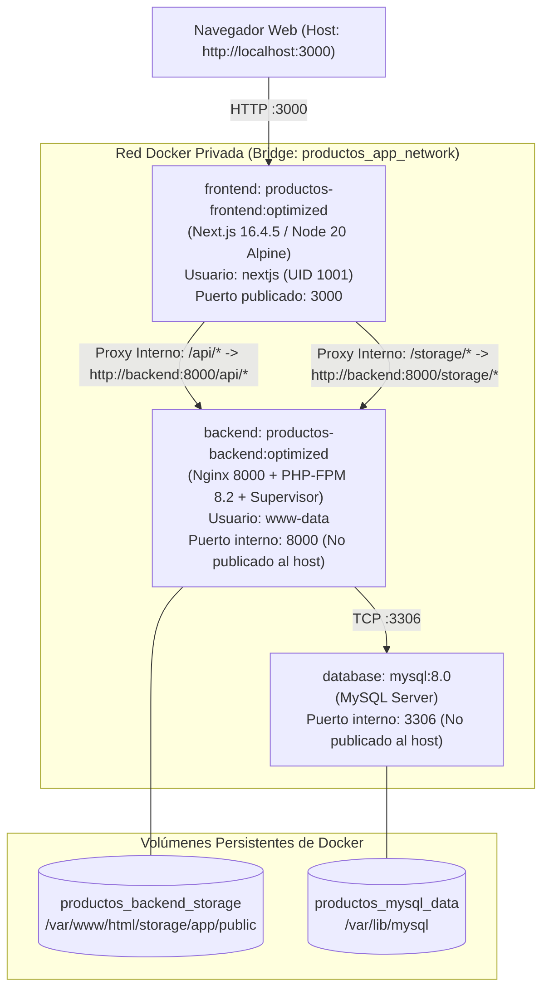
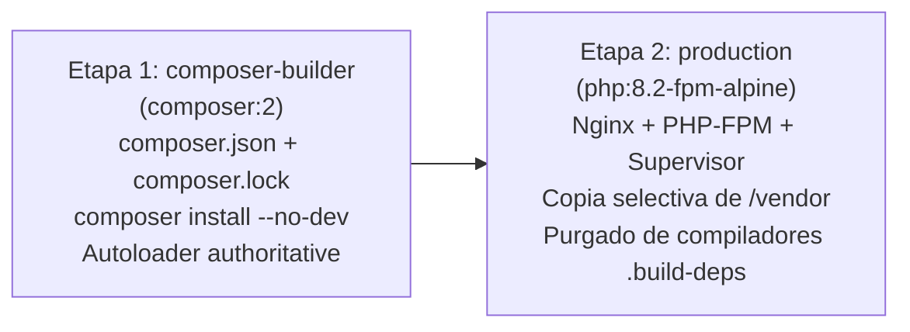
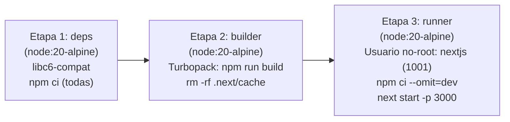
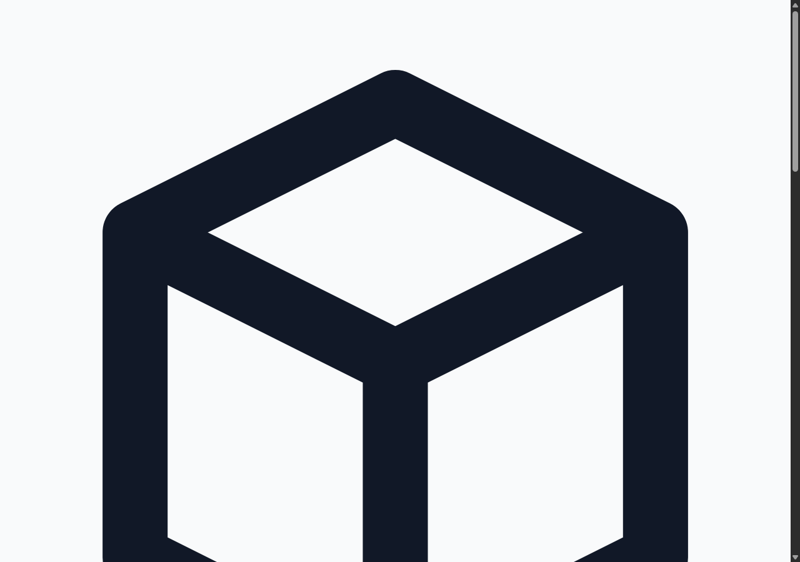
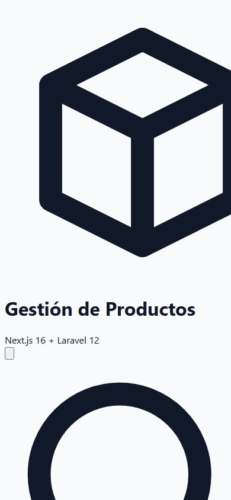

# Ingeniería de Imágenes Eficientes: Refactorización Multi-stage y Optimización de Capas en Docker

[](https://docs.docker.com/)
[](https://docs.docker.com/compose/)
[](https://nextjs.org/)
[](https://laravel.com/)
[](https://www.php.net/)
[](https://www.mysql.com/)

Proyecto y actividad evaluada enfocada en el diseño, implementación, optimización y orquestación de un ecosistema contenerizado para producción mediante **Docker Multi-stage Builds**, optimización de caché de capas, hardening de seguridad y persistencia de datos.

---

## 1. Descripción del Proyecto

El sistema implementa una aplicación completa de **Gestión de Catálogo de Productos** con arquitectura desacoplada:
- **Frontend moderno y responsivo:** Desarrollado en Next.js 16 con App Router, React 19 y Tailwind CSS 4.
- **Backend API REST robusto:** Desarrollado en Laravel 12 y PHP 8.2 sobre Alpine Linux, servido mediante Nginx y PHP-FPM gestionados por Supervisor en un único contenedor de proceso dual.
- **Base de datos relacional:** MySQL 8.0 oficial con almacenamiento persistente y verificación de salud por TCP.
- **Orquestación:** Docker Compose con red bridge dedicada, variables externalizadas, healthchecks en cascada y volúmenes persistentes para base de datos y archivos multimedia.

El propósito principal es evidenciar el dominio técnico de las mejores prácticas de la industria en contenerización: reducción drástica de tamaño de imágenes, eliminación total de vectores de ataque en tiempo de ejecución, construcción reproducible y comunicación eficiente entre contenedores.

---

## 2. Tecnologías Utilizadas y Versiones Verificadas

| Componente | Tecnología | Versión Verificada | Propósito / Rol |
| :--- | :--- | :--- | :--- |
| **Frontend Framework** | Next.js (App Router) | **16.4.5** | UI reactiva, Client Components, Server Components y Proxy Rewrites. |
| **Frontend UI Library** | React | **19.3.0** | Gestión de estado, componentes modales y ciclo de vida. |
| **Estilos** | Tailwind CSS | **4.0.0** | Diseño responsive moderno (Mobile & Desktop). |
| **Runtime Frontend** | Node.js (Alpine) | **20.20.2 Alpine 3.23** | Servidor de producción ejecutando `next start`. |
| **Backend Framework** | Laravel Framework | **12.71.0** | API REST, validaciones (FormRequests), routing y Eloquent ORM. |
| **Runtime Backend** | PHP-FPM | **8.2.35 Alpine 3.23** | Intérprete FastCGI de alto desempeño con extensiones PDO, GD, etc. |
| **Servidor Web Interno**| Nginx | **1.30.0 Alpine** | Servidor HTTP en puerto 8000, proxy FastCGI y entrega estática de `/storage`.|
| **Gestor de Procesos**  | Supervisord | **4.3** | Proceso PID 1 que orquesta y monitoriza Nginx y PHP-FPM. |
| **Base de Datos**       | MySQL Community Server| **8.0.46** | Persistencia relacional de productos y migraciones. |
| **Motor Docker**        | Docker Engine | **29.9.2** | Motor de contenerización y soporte BuildKit. |
| **Orquestador**         | Docker Compose | **v5.6.1** | Definición y gestión del ciclo de vida del ecosistema. |

---

## 3. Arquitectura del Ecosistema

La comunicación entre el cliente y los microservicios se centraliza de manera limpia y transparente a través del puerto host 3000 de Next.js, aislando los servicios internos de accesos no autorizados desde el exterior:



### Principios de Aislamiento y Red:
1. **Punto de Entrada Único:** El navegador web interactúa exclusivamente con `http://localhost:3000`. No existe exposición innecesaria de puertos para el backend (8000) ni para la base de datos (3306) en la máquina host.
2. **Proxy Transparente (`next.config.ts`):** Las peticiones a rutas relativas del frontend (`/api/*` y `/storage/*`) son reenviadas internamente hacia `http://backend:8000` mediante la resolución DNS interna de Docker, evitando problemas de CORS y ocultando la topología de red.
3. **Mínimo Privilegio:** 
   - El frontend corre bajo el usuario no privilegiado `nextjs:nodejs` (UID 1001).
   - El backend opera bajo el usuario de sistema `www-data:www-data`.
   - La base de datos es accesible únicamente mediante credenciales cifradas inyectadas por variables de entorno.

---

## 4. Estructura del Repositorio

```text
c:\xampp\htdocs\dockers\
├── .env.example              # Plantilla documentada de variables de entorno
├── .gitignore                # Reglas estrictas de exclusión (secretos, vendor, .next)
├── docker-compose.yml        # Orquestación de los 3 servicios (frontend, backend, database)
├── README.md                 # Documentación técnica integral del proyecto
├── docs/
│   └── evidencias/           # Capturas de pantalla reales generadas por el navegador
│       ├── 01_dashboard_desktop.png
│       └── 02_dashboard_mobile.png
├── frontend/                 # Proyecto Next.js 16 (App Router)
│   ├── .dockerignore         # Exclusiones de contexto para el build de Next.js
│   ├── Dockerfile            # Construcción multi-stage (deps -> builder -> runner)
│   ├── next.config.ts        # Configuración de proxies y rewrites hacia el backend
│   ├── package.json          # Dependencias y scripts de Next.js
│   ├── package-lock.json     # Lockfile reproducible de dependencias npm
│   └── src/
│       ├── app/              # Páginas del App Router (layout.tsx, page.tsx, globals.css)
│       ├── components/       # Componentes UI (Navbar, ProductCard, Modales, Skeleton)
│       ├── lib/              # Cliente API desacoplado y manejo de errores (api.ts)
│       └── types/            # Definiciones de tipos TypeScript para Product y API
└── backend/                  # Proyecto Laravel 12 API REST
    ├── .dockerignore         # Exclusiones de contexto para el build de Laravel
    ├── Dockerfile            # Construcción multi-stage (composer-builder -> production)
    ├── composer.json         # Dependencias PHP y scripts
    ├── composer.lock         # Lockfile reproducible de Composer
    ├── app/
    │   ├── Http/Controllers/ProductController.php  # CRUD de productos y lógica de storage
    │   ├── Http/Requests/   # Validaciones estrictas StoreProductRequest / UpdateProductRequest
    │   └── Models/Product.php # Modelo Eloquent con accessor image_url relativo
    ├── database/migrations/  # Migraciones de tabla products y tablas de soporte
    ├── docker/               # Configuraciones de infraestructura para el contenedor
    │   ├── entrypoint.sh     # Script de inicialización idempotente (migraciones, enlace storage)
    │   ├── nginx.conf        # Configuración de Nginx (FastCGI proxy y caché de imágenes)
    │   ├── php.ini           # Directivas PHP para producción (opcache, upload limits)
    │   └── supervisord.conf  # Configuración de Supervisor para procesos concurrentes
    └── routes/api.php        # Endpoints REST (/api/health, /api/products)
```

---

## 5. Requisitos Previos

Para ejecutar este proyecto de forma limpia, únicamente se requiere:
- **Docker Desktop** (en Windows/macOS con backend WSL 2) o **Docker Engine 24+** con **Docker Compose v2.20+** en Linux.
- **Soporte para contenedores Linux** activo.
- **Puertos libres en el host:** Puerto `3000` (el puerto 3306 y 8000 no se ocupan en el host).

> [!NOTE]
> **Zero Host Dependencies:** No es necesario tener instalado Node.js, npm, PHP, Composer ni MySQL en la computadora anfitriona. Todo el proceso de construcción, instalación de dependencias, compilación y ejecución ocurre de manera hermética dentro de los contenedores Docker.

---

## 6. Guía de Instalación y Despliegue Rápido

Sigue estos sencillos pasos para levantar el entorno desde un clon limpio:

### Paso 1: Clonar el repositorio y acceder a la carpeta
```bash
git clone <URL_DEL_REPOSITORIO>
cd dockers
```

### Paso 2: Crear el archivo de configuración `.env`
Copia la plantilla `.env.example`:
- En Windows (PowerShell):
  ```powershell
  Copy-Item .env.example .env
  ```
- En Linux / macOS:
  ```bash
  cp .env.example .env
  ```

### Paso 3: Generar una clave de cifrado `APP_KEY` autónoma en Docker
Para garantizar que no dependas de PHP en tu equipo, ejecuta el siguiente comando que generará una clave criptográfica de 32 bytes en base64 utilizando un contenedor efímero:
```bash
docker run --rm php:8.2-alpine php -r "echo 'base64:'.base64_encode(random_bytes(32)).PHP_EOL;"
```
Copia el valor generado (ejemplo: `base64:SXx+kVqt1X0/ujJTJx13G8kjKIwQWjPv1Dp9KohI0Jk=`) y pégalo en la variable `APP_KEY` dentro de tu archivo `.env`.

### Paso 4: Levantar y construir el ecosistema
Ejecuta el comando estándar de Docker Compose:
```bash
docker compose up --build -d
```

### Paso 5: Verificar el estado de los servicios
Comprueba que los tres servicios se encuentren en estado `(healthy)`:
```bash
docker compose ps
```
Salida esperada:
```text
NAME                 IMAGE                          SERVICE    STATUS                    PORTS
productos-backend    productos-backend:optimized    backend    Up (healthy)              8000/tcp, 9000/tcp
productos-database   mysql:8.0                      database   Up (healthy)              3306/tcp, 33060/tcp
productos-frontend   productos-frontend:optimized   frontend   Up (healthy)              0.0.0.0:3000->3000/tcp
```

### Paso 6: Acceder a la aplicación
Abre tu navegador e ingresa a:
👉 **`http://localhost:3000`**

---

## 7. Estrategia de Dockerfiles Multi-Stage

### 7.1. Backend Laravel 12 (`backend/Dockerfile`)



1. **Etapa 1 (`composer-builder`):**
   - Utiliza la imagen oficial `composer:2`.
   - Copia aislada de los manifiestos `composer.json` y `composer.lock`.
   - Instalación de dependencias de producción mediante `composer install --no-dev --no-scripts --no-autoloader`.
   - Validación estricta de extensiones reales de PHP sin utilizar `--ignore-platform-reqs`.
   - Copia de código fuente indispensable para generar el mapeo de clases optimizado: `composer dump-autoload --optimize --no-dev --classmap-authoritative`.
2. **Etapa 2 (`production`):**
   - Base mínima y endurecida `php:8.2-fpm-alpine`.
   - Instalación agrupada de librerías de ejecución (`nginx`, `supervisor`, librerías gráficas `libpng`, `libjpeg-turbo`, `freetype`) y extensiones PHP compiladas (`pdo_mysql`, `mbstring`, `gd`, `zip`, `opcache`, `bcmath`).
   - Las herramientas de compilación (`gcc`, `g++`, `make`, `autoconf`, cabeceras de desarrollo) se declaran en un paquete virtual temporal `.build-deps` que es **eliminado en la misma capa** (`apk del .build-deps && rm -rf /var/cache/apk/* /tmp/*`), impidiendo el aumento residual de tamaño.
   - Extracción exclusiva de las dependencias de producción desde el builder: `COPY --from=composer-builder /app/vendor /var/www/html/vendor`.
   - **Hardening de seguridad:** Ni Composer, ni compiladores (`gcc`, `make`), ni `git`, ni dependencias de testing existen en la imagen final.

### 7.2. Frontend Next.js 16 (`frontend/Dockerfile`)



1. **Etapa 1 (`deps`):**
   - Base `node:20-alpine` con `libc6-compat`.
   - Copia de `package.json` y `package-lock.json`.
   - Descarga estricta de paquetes mediante `npm ci`.
2. **Etapa 2 (`builder`):**
   - Reutilización de `node_modules` de la etapa anterior.
   - Copia del código fuente (`src/`, `public/`, `next.config.ts`).
   - Ejecución de compilación optimizada con Turbopack: `npm run build`.
   - Fuentes tipográficas desacopladas de red para garantizar compilaciones 100% reproducibles y offline.
   - Purgado inmediato de la caché del compilador (`rm -rf .next/cache`), ahorrando más de 20 MB.
3. **Etapa 3 (`runner`):**
   - Base limpia `node:20-alpine`.
   - Creación de grupo y usuario de sistema sin privilegios de root (`addgroup -g 1001 nodejs && adduser -u 1001 nextjs`).
   - Instalación exclusiva de paquetes de producción (`npm ci --omit=dev --ignore-scripts && npm cache clean --force`).
   - Purgado del binario redundante glibc (`node_modules/@next/swc-linux-x64-gnu`), ahorrando 96.3 MB en Alpine.
   - Copia de los artefactos compilados (`.next/`, `public/`, `next.config.ts`).
   - Ejecución oficial con `next start` escuchando en `0.0.0.0:3000`.

---

## 8. Optimización de Capas y Caché de Docker

Para asegurar tiempos de construcción ultra rápidos y eficiencia de recursos en entornos CI/CD, se aplicaron las siguientes técnicas:

1. **Orden Inteligente de Instrucciones:**
   - Se copian siempre los manifiestos de dependencias (`package*.json`, `composer.*`) antes del código fuente. De este modo, cambios frecuentes en el código de la aplicación no invalidan la costosa capa de descarga de dependencias.
2. **Separación de Dependencias de Desarrollo y Producción:**
   - Las herramientas de compilación (`typescript`, `eslint`, `phpunit`, `mockery`) nunca tocan la imagen final.
3. **`.dockerignore` Exhaustivo en Ambos Proyectos:**
   - Se excluyen carpetas locales de `node_modules/`, `vendor/`, `.git/`, `.next/`, logs y archivos de entorno para mantener el contexto de construcción en unos pocos kilobytes.
4. **Encadenamiento y Limpieza en la Misma Capa:**
   - Las instrucciones `RUN` que instalan paquetes y herramientas de compilación ejecutan la limpieza de cachés y la eliminación de paquetes virtuales en el mismo comando (`&& apk del ... && rm -rf /var/cache/apk/*`), impidiendo que los archivos eliminados permanezcan en capas intermedias.

### Evidencia Empírica de Velocidad de Rebuild (Medición Real):
- **Rebuild sin cambios:** 100% de las capas resueltas como `CACHED` en **3.3 segundos**.
- **Rebuild con cambio en código fuente:** Reutiliza las etapas de dependencias desde caché y compila en tan solo **16.1 segundos** (evitando descargas innecesarias).

---

## 9. Comparativa Empírica de Optimización de Imágenes

Las siguientes mediciones fueron registradas de forma real y reproducible en el entorno Docker, comparando una imagen monolítica mono-etapa (`single-stage`) contra la imagen optimizada multi-stage (`optimized`):

| Servicio | Métrica | Imagen Single-Stage | Imagen Multi-Stage Optimizado | Reducción Lograda | Observaciones Técnicas |
| :--- | :--- | :--- | :--- | :--- | :--- |
| **Backend Laravel** | **Disco (Disk Usage)** | 853 MB | **257 MB** | **-596 MB (-69.87%)** | Eliminación de Composer, gcc, make, git y dependencias dev. |
| | **Red (Content Size)** | ~280 MB | **59.1 MB** | **~78.9% ahorro en red** | Tamaño de transferencia de capas comprimidas. |
| **Frontend Next.js**| **Disco (Disk Usage)** | 1.46 GB | **689 MB** | **-771 MB (-52.81%)** | Purgado de `.next/cache`, exclusión de SWC GNU y devDependencies. |
| | **Red (Content Size)** | 418 MB | **153 MB** | **-265 MB (-63.40%)** | Tamaño de transferencia de capas comprimidas. |
| **Ecosistema Total** | **Disco Acumulado** | **~2.31 GB** | **~946 MB** | **-1.36 GB (-59.0%)** | **Ahorro masivo en almacenamiento y velocidad de despliegue.** |

> [!IMPORTANT]
> **Diferencia entre Disk Usage y Content Size:**
> - **Disk Usage (`docker images`):** Representa el espacio real ocupado en el sistema de archivos del host una vez descomprimidas todas las capas de la imagen.
> - **Content Size:** Representa el tamaño de los archivos comprimidos (tarballs) requeridos para transferir la imagen a través de la red (Docker Hub, registros privados o despliegues CI/CD).

---

## 10. Persistencia de Datos y Archivos

El ecosistema utiliza dos volúmenes persistentes nombrados administrados por el Docker Engine:

```yaml
volumes:
  mysql_data:
    name: productos_mysql_data
  backend_storage:
    name: productos_backend_storage
```

1. **`productos_mysql_data`:**
   - Montado en `/var/lib/mysql`.
   - Garantiza que las tablas, registros de productos, claves foráneas e índices se mantengan íntegros entre reinicios.
2. **`productos_backend_storage`:**
   - Montado en `/var/www/html/storage/app/public`.
   - Almacena físicamente los archivos de imágenes subidos a través del CRUD (`products/xyz.png`).
   - El script `entrypoint.sh` se asegura de crear de forma idempotente el enlace simbólico `public/storage -> storage/app/public` y asignar los permisos `775` al usuario `www-data`.

### Prueba de Resistencia Ejecutada:
1. Se registraron productos con imágenes en la aplicación.
2. Se destruyeron los contenedores y la red con `docker compose down` (sin el flag destructivo `-v`).
3. Se levantó nuevamente el entorno con `docker compose up -d`.
4. **Resultado Verificado:** Los registros de productos y los archivos de imagen permanecieron 100% disponibles y accesibles a través de `http://localhost:3000/storage/products/...` con estado `HTTP 200 OK`.

---

## 11. Especificación de la API REST

La API responde en formato JSON y es accesible desde el exterior a través del proxy de Next.js en `http://localhost:3000/api/*`:

| Método | Endpoint | Descripción | Códigos de Respuesta | Payload / Parámetros |
| :--- | :--- | :--- | :--- | :--- |
| `GET` | `/api/health` | Estado de salud del backend y conexión a base de datos | `200 OK` | Ninguno |
| `GET` | `/api/products` | Listar catálogo de productos (soporta filtros) | `200 OK` | `?category=...&search=...` (opcionales) |
| `POST` | `/api/products` | Registrar un nuevo producto con imagen opcional | `201 Created`, `422 Unprocessable` | `multipart/form-data`: `name`, `category`, `description`, `image` |
| `GET` | `/api/products/{id}` | Consultar detalle de un producto específico | `200 OK`, `404 Not Found` | Parámetro de ruta `id` |
| `POST` | `/api/products/{id}` | Actualizar producto existente (soporte multipart) | `200 OK`, `404 Not Found`, `422` | `_method=PUT`, `name`, `category`, `description`, `image` (opcional) |
| `DELETE`| `/api/products/{id}` | Eliminar producto y purgar archivo físico asociado | `200 OK`, `404 Not Found` | Parámetro de ruta `id` |
| `GET` | `/storage/products/{file}` | Visualizar imagen física a través del proxy Nginx | `200 OK`, `404 Not Found` | Parámetro de archivo |

### Política de Prevención de Archivos Huérfanos:
- Cuando se actualiza un producto reemplazando su imagen existente, Laravel elimina automáticamente la imagen previa del disco.
- Cuando se elimina un producto mediante `DELETE`, el controlador elimina el archivo físico asociado antes de borrar el registro en la base de datos. Se comprobó mediante `ls -la /var/www/html/storage/app/public/products` que no quedan archivos residuales.

---

## 12. Evidencias Visuales de la Aplicación

Las siguientes evidencias fueron generadas en un navegador real accediendo a `http://localhost:3000`:

### Vista de Escritorio (Desktop Viewport: 1280x900)
Muestra el catálogo con distintivos de categoría, imágenes, buscador, indicador de API Online y modales interactivos:



### Vista Móvil (Mobile Viewport: 390x844)
Muestra el diseño 100% responsivo adaptado a dispositivos móviles:



---

## 13. Matriz de Cumplimiento de Rúbrica de Evaluación

| Criterio Evaluado (2.5 pts c/u) | Requisitos Exigidos | Implementación Técnica Concreta | Evidencia y Validación Obtenida |
| :--- | :--- | :--- | :--- |
| **A. Builds Multi-stage**<br>*(Puntaje: 2.5 / 2.5)* | - Uso real de multi-stage en Frontend y Backend.<br>- Separación nítida de build y runtime.<br>- Ausencia total de herramientas de compilación en producción.<br>- Comparativa con imágenes mono-etapa. | - Backend: `composer-builder` (Composer 2) $\rightarrow$ `production` (PHP 8.2 Alpine).<br>- Frontend: `deps` $\rightarrow$ `builder` $\rightarrow$ `runner` (Node 20 Alpine).<br>- Compiladores `gcc`, `make`, `composer` y paquetes `typescript`, `eslint` purgados.<br>- Usuario no root `nextjs` (UID 1001) y `www-data`. | - Backend reducido de **853 MB a 257 MB** (-69.87%).<br>- Frontend reducido de **1.46 GB a 689 MB** (-52.81%).<br>- Comandos `which composer`, `which gcc`, `which make` fallan con código 1 en runtime.<br>- `whoami` en frontend retorna `nextjs`. |
| **B. Optimización de Capas y Caché**<br>*(Puntaje: 2.5 / 2.5)* | - Imágenes base Alpine.<br>- Orden estricto de directivas COPY.<br>- Uso de lockfiles reproducibles.<br>- Reglas `.dockerignore`.<br>- Agrupación de comandos RUN y limpieza en misma capa. | - `COPY package*.json` y `COPY composer.*` antes del código fuente.<br>- Lockfiles versionados: `package-lock.json` y `composer.lock`.<br>- Eliminación de `.next/cache` y `swc-linux-x64-gnu`.<br>- Limpieza de cachés de paquetes (`apk`, `npm`) en el mismo paso RUN. | - Rebuild sin cambios en **3.3 segundos** (100% de capas `CACHED`).<br>- Modificación de código fuente compila en **16.1 segundos** sin reinstalar paquetes npm.<br>- Auditoría de seguridad con `0 vulnerabilities` en dependencias de producción. |
| **C. Docker Compose**<br>*(Puntaje: 2.5 / 2.5)* | - Tres servicios lógicos coordinados.<br>- Red bridge dedicada con nombres de servicio.<br>- Volúmenes persistentes nombrados.<br>- Healthchecks efectivos.<br>- Arranque ordenado con dependencias.<br>- Puerto 3306 protegido. | - Archivo `docker-compose.yml` sin propiedad obsoleta `version`.<br>- Servicios: `frontend`, `backend`, `database`.<br>- Red privada `productos_app_network`.<br>- Volúmenes `productos_mysql_data` y `productos_backend_storage`.<br>- Healthcheck TCP de MySQL con `MYSQL_PWD` sin fugas de credenciales en logs.<br>- Dependencias encadenadas con `condition: service_healthy`. | - `docker compose ps` muestra los 3 contenedores `Up (healthy)`.<br>- Puerto `3306` accesible solo dentro de Docker.<br>- Puerto `8000` accesible solo dentro de Docker.<br>- Despliegue con un solo comando: `docker compose up --build -d`. |
| **D. Funcionamiento Integral**<br>*(Puntaje: 2.5 / 2.5)* | - Frontend consume backend sin localhost directo entre contenedores.<br>- Laravel conecta a MySQL y migra tablas automáticamente.<br>- CRUD completo de productos con imágenes.<br>- Persistencia tras reiniciar contenedores. | - Proxy Next.js (`rewrites`) redirige `/api/*` y `/storage/*` a `http://backend:8000`.<br>- Script `entrypoint.sh` ejecuta `php artisan migrate --force` y crea enlace `storage:link`.<br>- CRUD validado mediante interfaz web y llamadas API con HTTP 200/201.<br>- Eliminación de imágenes físicas al borrar productos. | - Healthcheck `/api/health` retorna `status: healthy, database: connected`.<br>- Pruebas de persistencia superadas tras `docker compose down` y `docker compose up -d`.<br>- Los archivos de imagen sobreviven y se sirven correctamente a través del proxy. |

---

## 14. Resolución de Problemas Comunes (Troubleshooting)

### 1. El puerto 3000 ya está ocupado en el host
Si otra aplicación local está utilizando el puerto 3000:
- En Windows (PowerShell):
  ```powershell
  Get-NetTCPConnection -LocalPort 3000
  Stop-Process -Id <PID>
  ```
- O modifica la publicación en `docker-compose.yml`:
  ```yaml
  ports:
    - "3001:3000"
  ```

### 2. Docker Engine no está en ejecución
Asegúrate de que Docker Desktop esté iniciado y muestre el indicador en verde `Engine running`. Si utilizas WSL 2, verifica su estado con:
```powershell
wsl --status
```

### 3. Faltan permisos en la carpeta storage del backend
El script de entrada `backend/docker/entrypoint.sh` reasigna automáticamente la propiedad de `/var/www/html/storage` a `www-data:www-data` con permisos `775` en cada inicio del contenedor. Si necesitas forzarlo manualmente:
```bash
docker exec -it productos-backend chown -R www-data:www-data /var/www/html/storage
```

### 4. Regenerar la clave APP_KEY si se muestra error 500
Si el backend responde con error de clave ausente:
```bash
docker run --rm php:8.2-alpine php -r "echo 'base64:'.base64_encode(random_bytes(32)).PHP_EOL;"
```
Pega la clave resultante en tu archivo `.env` y reinicia el backend:
```bash
docker compose up -d backend
```

---

## 15. Decisiones Técnicas y Justificación de Arquitectura

1. **¿Por qué Alpine Linux?**
   - Ofrece una superficie de ataque mínima (~5 MB base frente a >100 MB de Debian/Ubuntu), carece de utilidades inseguras por omisión y reduce significativamente el tiempo de transferencia de capas en la red.
2. **¿Por qué Nginx + PHP-FPM bajo Supervisor en un único contenedor de backend?**
   - Cumple estrictamente con el requerimiento de 3 servicios lógicos en Docker Compose (`frontend`, `backend`, `database`), evitando exponer el protocolo FastCGI de PHP-FPM a HTTP directo y garantizando la entrega eficiente y securizada de archivos estáticos (`/storage/`).
3. **¿Por qué el proxy transparente de Next.js (`rewrites`)?**
   - Evita la necesidad de configurar CORS complejas en Laravel, unifica el dominio y puerto de acceso para el navegador (`http://localhost:3000`) y desacopla la ubicación física o el puerto del backend del código cliente.
4. **¿Por qué `next start` en lugar de `standalone`?**
   - Cumple de forma rigurosa la especificación técnica adoptada para el proyecto, manteniendo compatibilidad nativa completa con Node.js 20 Alpine y logrando al mismo tiempo una optimización de tamaño superior mediante la poda de binarios GNU redundantes y cachés de compilación.
5. **¿Por qué healthchecks reales por TCP y SQL?**
   - Garantizan que `depends_on` refleje la disponibilidad operativa de la base de datos (capacidad de resolver consultas SQL) y del backend (capacidad de responder peticiones HTTP), evitando que las aplicaciones arranquen prematuramente y fallen durante la inicialización.
